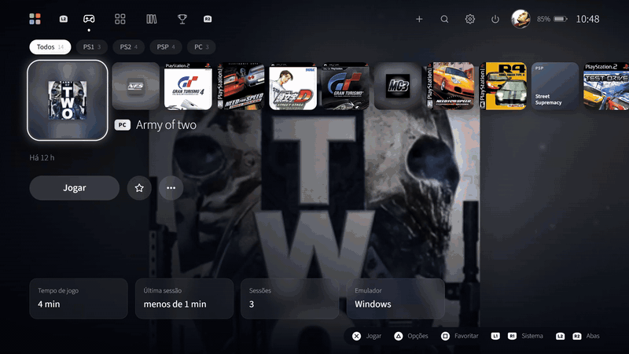
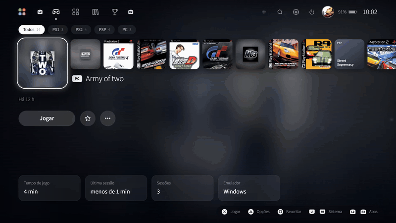
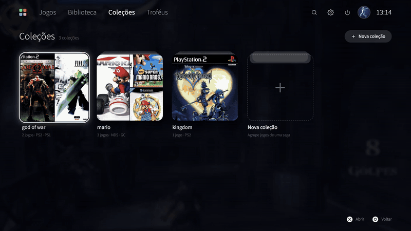
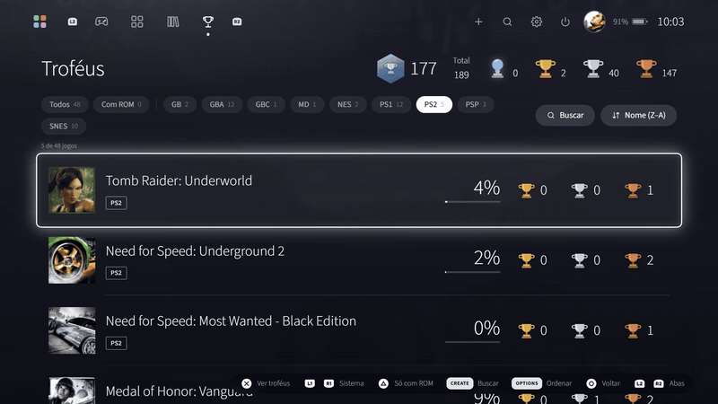

# PlayDeck

Launcher de emuladores em tela cheia, no estilo do PS5, feito para jogar com controle:
Xbox/XInput, DualShock 4 (PS4) e DualSense (PS5), via USB ou Bluetooth, sem precisar de Steam ou DS4Windows.
Lê todas as suas ROMs, abre cada jogo no emulador certo e é portable: copie a pasta e jogue.

▶️ **[Vídeo de demonstração](docs/media/playdeck-demo.mp4)** (1 min 24 s)

## Telas

**Tela de jogos** — navegação pelo controle, capa e arte do jogo, filtros por sistema



**Coleções** — agrupe os jogos de uma saga



**Escolha de avatar**



**Troféus (RetroAchievements)** — lista e grade, com troca entre tema escuro e claro



## Como usar

1. Baixe o `PlayDeck-0.9.0-win-x64.zip` na aba [Releases](https://github.com/felipeAguiarCode/PS5EmuShell/releases).
2. Crie uma pasta base (ex.: `C:\Emuladores`) e extraia o zip dentro dela. Vai ficar `C:\Emuladores\launcher`.
3. Execute `launcher\Iniciar.bat`.
4. Na primeira vez, o PlayDeck oferece criar as pastas ao lado do launcher e baixar os emuladores:

```
Emuladores\
  launcher\     ← o PlayDeck
  bios\  cores\  roms\  saves\  screenshots\
```

5. Coloque as ROMs em `roms\<sistema>` (`psx`, `ps2`, `psp`, `nds`, `gc`, `gba`, `snes`…).

As capas são baixadas sozinhas. As BIOS você copia para `..\bios\<sistema>`.

## Controles

| Botão | Ação |
|---|---|
| ✕ / A | Jogar / confirmar |
| ○ / B | Voltar |
| △ / Y | Opções do jogo |
| L1 / R1 | Trocar sistema |
| Options / Start | Configurações (no teclado virtual: confirmar) |
| Segurar Select + Start | Fechar o jogo e voltar ao launcher |

## Configurações

- **Controles** — até 4 jogadores. Todo controle conectado entra sozinho no próximo slot livre
  (a barra de luz do DualShock 4/DualSense acende na cor do jogador). Tem **Autodetectar** e
  **Testar**, que mostra o diagrama do controle com cada botão, direcional, gatilho e analógico ao vivo.
- **Instalação** — baixar, atualizar ou sincronizar emuladores (mostra a versão instalada e a última).
- **RetroAchievements** — login em todos os emuladores compatíveis e regras dos troféus.
- **Aparência** — tema escuro/claro, animações, imagem de fundo e miniaturas.
- **Atalhos**, **Otimização** (liberar RAM antes de jogar) e mais.

## Compartilhar

Copie a pasta `Emuladores` inteira — todos os caminhos são relativos.
Antes, apague `launcher\data` para não levar suas configurações, tempo de jogo e login.

## Desenvolvimento

Requisitos: Windows 10/11 (x64), [Node.js](https://nodejs.org) 20 ou mais novo e Git.

```
git clone https://github.com/felipeAguiarCode/PS5EmuShell.git launcher
cd launcher
npm install
npm start          # roda a partir do código-fonte (modo desenvolvedor)
npm run build      # gera app\win-unpacked\PlayDeck.exe
```

Clone dentro da sua pasta base (ex.: `C:\Emuladores`), porque o launcher procura `bios`, `cores` e `roms` na pasta acima dele.

Se o npm bloquear os scripts de instalação (aviso `install-scripts`), rode-os uma vez à mão:

```
node node_modules/electron/install.js
```

Atalhos úteis no modo desenvolvedor: **F12** abre o DevTools, **F11** alterna a tela cheia.
Os dados pessoais (config, tempo de jogo, login do RetroAchievements) ficam em `data\`, que não vai para o Git.

Estrutura:

| Pasta | Conteúdo |
|---|---|
| `src/main` | Processo principal: controles (XInput + HID), emuladores, instalação, RetroAchievements |
| `src/main/retroachievements` | Um script por emulador para configurar o login |
| `src/renderer` | Interface (HTML/CSS/JS sem framework) |
| `assets/avatars` | Avatares do perfil |

Ícones de botões: [Kenney Input Prompts](https://kenney.nl/assets/input-prompts) (CC0). Fonte: Source Sans 3 (SIL OFL).
