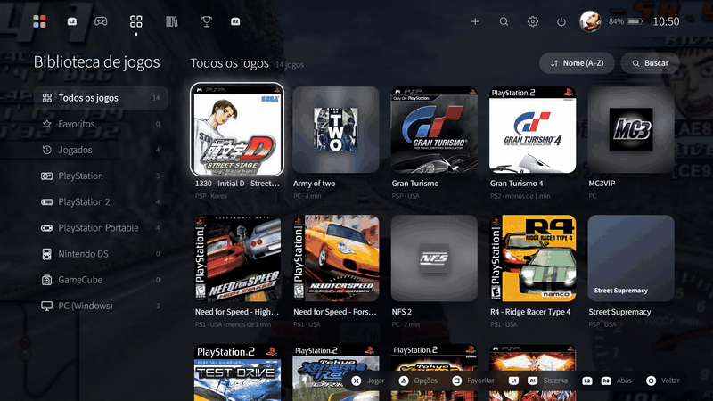

<div align="center">


# PS5 Emu Shell

**Seus emuladores, recomps e jogos de PC numa interface no estilo do PS5, feita para o controle.**

<a href="https://github.com/felipeAguiarCode/PS5EmuShell/releases/latest">
  
</a>

<a href="https://github.com/felipeAguiarCode/PS5EmuShell/releases/latest"></a>


[Telas](#telas) · [Instalação](#instalação) · [Requisitos](#requisitos) · [Sistemas](#sistemas-e-emuladores) · [Controles](#controles) · [FAQ](#perguntas-frequentes) · [Arquitetura](#arquitetura)

</div>

> [!IMPORTANT]
> **Isto NÃO é um emulador de PS5.** O PS5 Emu Shell é um **launcher agregador de emuladores**: organiza seus jogos e abre cada um no emulador certo. Ele não roda jogos de PS5 (nem GTA 6). Veja as [perguntas frequentes](#perguntas-frequentes).

## Destaques

|  |  |
|---|---|
| 🎮 **Feito para o controle** | Xbox/XInput, DualShock 4 e DualSense por USB ou Bluetooth, sem Steam nem DS4Windows. Até 4 jogadores. |
| 🗂️ **Tudo num lugar só** | ROMs de 19 consoles, recomps e jogos de PC na mesma biblioteca, com capas baixadas sozinhas. |
| ⚙️ **Emuladores sem esforço** | Baixa e atualiza cada emulador da fonte oficial, ou usa o executável que você já tem. |
| 🏆 **Troféus** | Conquistas do RetroAchievements no estilo do PS5, com login automático nos emuladores compatíveis. |
| 💼 **Portable** | Todos os caminhos são relativos: copie a pasta e jogue em outro PC. |

▶️ **[Assista ao vídeo de demonstração](docs/media/ps5-emu-shell-demo.mp4)** (1 min 19 s)

## Telas

### Tela de jogos

Fileira de jogos no estilo do PS5, com a arte do jogo no fundo, filtros por console (L1/R1) e opções do jogo (△/Y).


### Coleções

Agrupe os jogos de uma saga. A capa é montada com as capas dos jogos ou pode ser uma imagem sua (△/Y › Capa).


### Teclado virtual

No estilo do PS5, com páginas de letras, símbolos e acentos, Shift e cursor móvel, tudo pelo controle.



### Troféus

Progresso de cada jogo no RetroAchievements, em lista ou em grade, no tema escuro ou claro.


### Avatar

Dezenas de avatares incluídos, ou uma imagem sua.


## Instalação

1. Baixe o `PS5EmuShell-<versão>-win-x64.zip` na **[última versão](https://github.com/felipeAguiarCode/PS5EmuShell/releases/latest)**.
2. Crie uma pasta base (ex.: `C:\Emuladores`) e extraia o zip dentro dela.
3. Execute `launcher\Iniciar.bat`.
4. Na primeira vez, aceite criar as pastas e baixar os emuladores:

```
Emuladores\
├── launcher\      ← o PS5 Emu Shell
├── bios\          ← BIOS e firmwares, por sistema
├── cores\         ← emuladores
├── roms\          ← jogos: roms\psx, roms\ps2, roms\psp, roms\nds, roms\gc…
├── saves\
└── screenshots\
```

5. Coloque as ROMs em `roms\<sistema>` e as BIOS em `bios\<sistema>`. As capas são baixadas sozinhas.

> [!TIP]
> **Para atualizar**, extraia o zip da nova versão por cima da pasta `launcher`. Suas configurações, seu tempo de jogo e seu login ficam em `launcher\data` e são mantidos.

## Requisitos

| | Mínimo para o launcher |
|---|---|
| **Sistema** | Windows 10 ou 11, 64 bits |
| **Processador** | Qualquer x64 |
| **Memória** | 4 GB de RAM |
| **Vídeo** | Placa compatível com DirectX 11 |
| **Disco** | 500 MB livres, mais o espaço dos emuladores e jogos |
| **Controle** | Opcional: Xbox/XInput, DualShock 4 ou DualSense. Teclado e mouse também funcionam |
| **Internet** | Opcional: só para capas, emuladores e RetroAchievements |

Os jogos rodam nos emuladores, e cada um tem seus próprios requisitos: veja **[requisites.md](requisites.md)**.

## Sistemas e emuladores

| Sistema | Emulador |
|---|---|
| PlayStation | DuckStation |
| PlayStation 2 | PCSX2 |
| PlayStation Portable | PPSSPP |
| Nintendo DS | melonDS, DeSmuME, NooDS |
| GameCube | Dolphin |
| Game Boy Advance · Game Boy Color | mGBA, RAVBA |
| Nintendo (NES) | Mesen, RANes, FCEUX |
| Super Nintendo | Snes9x, RASnes9x |
| Mega Drive / Genesis | ares |
| Nintendo 64 | Rosalie's Mupen GUI, Project64 |
| Dreamcast | Flycast |
| Wii · Wii U | Dolphin · Cemu |
| Nintendo 3DS | Azahar |
| Xbox · Xbox 360 | xemu · Xenia Canary |
| PlayStation 3 | RPCS3 |
| PlayStation 4 | shadPS4 |

PlayStation, PS2, PSP, Nintendo DS e GameCube já vêm configurados; os demais entram em **Configurações › Instalação › Adicionar mais sistemas**. Cada emulador pode **baixar a última versão** da fonte oficial ou **apontar para o seu próprio executável**; se você instalar por fora, extraia em `cores\<sistema>\<emulador>` e use **Sincronizar**.

Jogos de PS3 e PS4 ficam em pastas (com `EBOOT.BIN` / `eboot.bin`) dentro de `roms\ps3` ou `roms\ps4`, e o nome é lido do `PARAM.SFO`. Firmware, BIOS e chaves são configurados no próprio emulador.

## Jogos de PC, recomps e pastas de ROMs

O botão **+** no topo adiciona:

- **Jogo de PC ou recomp:** escolha o `.exe` num explorador de arquivos que funciona pelo controle e já mostra as pastas da Steam, Epic, GOG e Xbox. A imagem vem do ícone do executável, e o launcher acompanha o jogo até o último processo da pasta fechar.
- **Pasta de ROMs:** escolha a pasta e o sistema. O PS5 Emu Shell sugere o sistema pelos arquivos e pelo nome da pasta.

Renomear, trocar o executável, mudar as **Thumbnails** ou remover: △/Y no jogo. Em **Informações** há também **Resetar estatísticas**.

## Controles

<table>
<tr><th>No launcher</th><th>Teclado virtual</th></tr>
<tr valign="top"><td>

| Botão | Ação |
|---|---|
| ✕ / A | Jogar / confirmar |
| ○ / B | Voltar |
| △ / Y | Opções do jogo |
| □ / X | Favoritar |
| L1 / R1 | Trocar o console |
| L2 / R2 | Trocar de aba |
| Options / Start | Configurações |
| Create / Back | Buscar |
| PS / Guide | Tela de jogos |

</td><td>

| Botão | Ação |
|---|---|
| ✕ / A | Digitar |
| L2 | Shift (2× trava) |
| R3 | ABC · @#: · à |
| △ / Y | Espaço |
| □ / X | Apagar |
| L1 / R1 | Mover o cursor |
| R2 / Options | Confirmar |
| ○ / B | Cancelar |

</td></tr>
</table>

**Durante o jogo**

| Atalho | Ação |
|---|---|
| Segurar **Create/Back + Options/Start** | Fechar o jogo e voltar ao launcher |
| Segurar **Create/Back + L1** | Mostrar o launcher por cima do jogo |
| **Ctrl+Shift+Q** · **Ctrl+Shift+L** | As mesmas ações pelo teclado |

As combinações podem ser trocadas em **Configurações › Atalhos**.

## Configurações

| Página | O que dá para fazer |
|---|---|
| **Controles** | Até 4 jogadores com slots automáticos, barra de luz na cor do jogador, **Autodetectar** e **Testar** com o diagrama ao vivo |
| **Instalação** | Baixar, atualizar ou sincronizar emuladores, com a versão instalada e a última disponível |
| **RetroAchievements** | Login em todos os emuladores compatíveis e regras dos troféus |
| **Aparência** | Tema escuro ou claro, animações, menu com ícones ou nomes, imagem de fundo com efeito **Normal**, **Blur** ou **Filtro escuro** |
| **Atalhos · Otimização · Capas · Biblioteca** | Combinações durante o jogo, liberar RAM antes de jogar, cache de capas e pastas de ROMs |

## Perguntas frequentes

**Isso é um emulador de PS5?**

Não. O PS5 Emu Shell é um **launcher**: não emula nenhum console, só organiza a sua biblioteca e abre cada jogo no programa certo. Quem roda os jogos são os emuladores, os recomps e os jogos de PC que você já tem. A aparência lembra a do PS5, mas é só a interface.

**Qual é a proposta, então?**

Ser um **centralizador de jogos**: juntar, numa interface feita para o controle, os jogos dos seus emuladores, os **recomps** (versões nativas para PC de jogos clássicos) e os seus jogos de PC.

**Isso vai rodar GTA 6?**

Não. O PS5 Emu Shell não emula PS5 nem nenhum console atual. Ele só abre o que você já consegue rodar no seu PC.

**Quais são os requisitos?**

O launcher é leve ([Requisitos](#requisitos)). Os jogos dependem de cada emulador: sistemas antigos rodam até em PCs modestos, enquanto PS3, PS4, Xbox 360 e Wii U pedem um PC forte. Veja [requisites.md](requisites.md).

**O PS5 Emu Shell vem com jogos ou BIOS?**

Não. Os emuladores podem ser baixados pelo launcher, das fontes oficiais, mas jogos, BIOS e firmwares não acompanham. Use apenas cópias dos jogos que você tem.

**O Windows mostrou um aviso do SmartScreen. É seguro?**

O executável não é assinado digitalmente, então o Windows avisa na primeira execução. Clique em **Mais informações** › **Executar assim mesmo**. O código-fonte completo está neste repositório.

**Meu controle de PlayStation não funciona. Preciso do DS4Windows?**

Não. O DualShock 4 e o DualSense são lidos direto. Se o controle não aparecer, use **Configurações › Controles › Autodetectar** e feche o DS4Windows, se estiver aberto, porque ele pode esconder o controle original.

**Como fecho um jogo e volto para o launcher?**

Segure **Create/Back + Options/Start**. Para só mostrar o launcher sem fechar o jogo, segure **Create/Back + L1**.

**Coloquei ROMs na pasta, mas os jogos não aparecem.**

Confira se estão em `roms\<sistema>`, com uma extensão que o emulador aceita, e se o sistema está ativo em **Configurações › Sistemas e emuladores**. Para pastas fora de `roms`, use **+** › Pasta de ROMs.

**As capas não baixaram.**

As capas são buscadas pelo nome do arquivo, então nomes no padrão No-Intro/Redump (ex.: `Gran Turismo 4 (USA).iso`) funcionam melhor. Em **Configurações › Capas** dá para baixar de novo ou limpar o cache.

**Como levo tudo para outro PC?**

Copie a pasta `Emuladores` inteira. Se for compartilhar com outra pessoa, apague antes `launcher\data` para não levar suas configurações e seu login.

**Onde ficam meus dados?**

Em `launcher\data`: configuração, tempo de jogo, coleções, login do RetroAchievements e cache de capas. A internet só é usada para baixar capas e emuladores, checar versões novas e consultar o RetroAchievements.

## Desenvolvimento

Requisitos: Windows 10/11 x64, [Node.js](https://nodejs.org) 20+ e Git. Clone dentro da pasta base (ex.: `C:\Emuladores`), porque o launcher procura `bios`, `cores` e `roms` na pasta acima dele.

```bash
git clone https://github.com/felipeAguiarCode/PS5EmuShell.git launcher
cd launcher
npm install
npm start          # roda a partir do código-fonte (F12 abre o DevTools, F11 alterna a tela cheia)
npm run check      # ESLint + Prettier + testes (node:test)
npm run build      # gera app\win-unpacked\PS5EmuShell.exe
```

Se o npm bloquear os scripts de instalação (aviso `install-scripts`), rode uma vez `node node_modules/electron/install.js`.
## Arquitetura

Electron com dois processos: o **main** (Node.js) cuida de controles, arquivos, emuladores e rede; o **renderer** (HTML/CSS/JS sem framework) desenha a interface. Os dois conversam por IPC, através do `preload.cjs`.

```
📁 launcher/
├── 📁 src/
│   ├── 📁 main/                      processo principal (Node.js)
│   │   ├── 🟨 index.js               ciclo de vida do app e ligação das camadas
│   │   ├── 📁 constants/             constantes por contexto e mensagens da interface
│   │   ├── 📁 core/                  caminhos, config.json, stats.json e log
│   │   ├── 📁 defaults/              configuração padrão e catálogo de sistemas
│   │   ├── 📁 ipc/                   canais IPC, um arquivo por contexto
│   │   ├── 📁 input/                 XInput, HID (DualShock 4/DualSense), slots e combos
│   │   ├── 📁 library/               ROMs, capas, jogos de PC, coleções, avatares, tempo de jogo
│   │   ├── 📁 emulators/             downloads, instalação, versões, sincronização e execução
│   │   ├── 📁 retroachievements/
│   │   │   ├── 📁 api/               web API e caches
│   │   │   ├── 📁 formats/           INI e token do DuckStation
│   │   │   └── 📁 emulators/         um script de login por emulador
│   │   ├── 📁 system/                bateria, processos, desempenho e otimização
│   │   ├── 📁 files/                 explorador de arquivos e detecção de sistema
│   │   ├── 📁 window/                janela principal, overlay do jogo e atalhos
│   │   └── 📁 dev/                   modo snapshot (capturas e gravações automáticas)
│   ├── 🟨 preload.cjs                ponte segura entre main e renderer
│   └── 📁 renderer/                  interface
│       ├── 📄 index.html
│       ├── 📁 scripts/
│       │   ├── 🟨 main.js            inicialização da interface
│       │   ├── 📁 core/              estado, comandos, API e seletores
│       │   ├── 📁 input/             controle, teclado e mouse
│       │   ├── 📁 navigation/        navegação espacial pelo controle
│       │   ├── 📁 ui/                modal, toast, glyphs, sons e teclado virtual
│       │   └── 📁 views/             uma pasta por tela: home, library, collections,
│       │                             trophies, settings, game, pc-games, topbar…
│       ├── 📁 styles/                CSS por tela, na ordem da cascata
│       ├── 📁 fonts/                 Source Sans 3
│       └── 📁 img/                   ícones de botões e troféus
├── 📁 test/                          testes node:test (main e renderer)
├── 📁 assets/avatars/                avatares do perfil
├── 📁 build/                         ícone e script pós-empacotamento
├── 📁 docs/media/                    GIFs e vídeo deste README
└── 📄 .specs/coding-style.md         guia de estilo do código
```

## Créditos

Ícones de botões: [Kenney Input Prompts](https://kenney.nl/assets/input-prompts) (CC0) · Fonte: [Source Sans 3](https://github.com/adobe-fonts/source-sans) (SIL OFL) · Troféus: [RetroAchievements](https://retroachievements.org) · Capas: [libretro-thumbnails](https://github.com/libretro-thumbnails/libretro-thumbnails)
